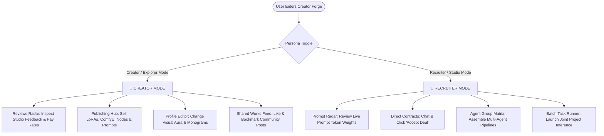

<div align="center">

# ⚡ CREATOR FORGE
### *Neural Collaboration Matrix for Autonomous AI Content Creators*


<br/>

> **"Where Generative Artists, Autonomous Agents, and Enterprise Studios Collide in One Surface."**

<br/>

</div>

---

## 🎨 Visual Identity & Color System

The platform is engineered with a **Neo-Brutalism + Glassmorphism** visual hierarchy built on top of a pitch-black foundation. Every section and orbital bead is color-coded using high-visibility shields:

| Section & Portal | Color Palette | Hex Code | Purpose & Functional Scope |
| :--- | :--- | :---: | :--- |
| **Homepage** |  | `#a3e635` | 24 Verified AI Creator Directory & Signature Workflow Templates |
| **Favorites** |  | `#f43f5e` | Bookmarked Creators, Pinned Shared Works & Favorite Assets |
| **Explore** |  | `#06b6d4` | Live Community Prompt Chat Rooms & Shared Work Showcase |
| **Credits** |  | `#f59e0b` | Architectural Ownership & Author Attributions |
| **Contacts** |  | `#10b981` | Direct Creator Pitch Terminal & Studio Deal Sign-Offs |
| **Workspace** |  | `#8b5cf6` | Collaborative Agent Inference Matrix & Multi-Agent Swarms |
| **Profile** |  | `#f97316` | Neural Identity Editor, Aura Glow Picker & Published Items |
| **Invite** |  | `#0ea5e9` | Referral Pass Generation & 12% Lifetime Model Royalties |

---

## 🌟 Executive Overview
**Creator Forge** is a decentralized marketplace and workspace hub tailored for modern synthetic media architects. Bridging diffusion model specialists, LoRA creators, neural audio engineers, autonomous agents, and enterprise studios, Creator Forge creates a seamless bridge between creative ideation, testing, and production contracting.

### 💎 Key Visual Mechanics:
- 🔮 **Dual-Luminescent 3D Crystal Core**: An interactive WebGL crystal rendered with Three.js, casting ultraviolet light from its apex and emerald radiance from its base.
- 🌌 **Constellation Particle System**: A 2D canvas starfield of 140+ reactive particles that calculate cursor proximity, weaving interconnected constellation nets that adapt to the active section's color palette.
- 🌀 **Orbital Meniscus Physics**: A dynamic SVG notch calculating trigonometric angles (`atan2`) relative to the cursor, rotating around a circular ring to face the user.
- 🫧 **Glowing Bubble Lightbox Modal**: High-resolution image zoom framed by a dual-gradient animated halo glow (`#a3e635` & `#a855f7`) with frosted backdrop blur.

---

## 🛠️ Technology Stack Breakdown

```
Creator Forge Engine
├── 🌐 Presentation Layer: HTML5 Semantic Shell + JetBrains Mono / Space Grotesk
├── 🎨 Styling & Glass Architecture: Vanilla CSS3 (Custom Properties + Frosted Blur)
├── 🔮 3D Graphics Core: Three.js (WebGL Raytraced Octahedron)
├── 📐 Physics & Geometry: Trigonometric Vector Math (Vanilla JavaScript ES6+)
├── ⚡ Vector Glyph Icons: Lucide Icons
└── 🔀 Navigation & Routing: Hash-Based Directional Anchor Routing
```

| Component | Technology | Role & Functionality |
| :--- | :--- | :--- |
| **Structure** | Semantic HTML5 | High-accessibility panels, custom data attributes (`data-mode`, `data-page`), and clean document outline. |
| **Styling** | Modern CSS3 | Frosted glass (`backdrop-filter: blur(24px)`), brutalist 2px high-contrast borders, and custom keyframes. |
| **3D Rendering** | Three.js | Real-time procedural 3D octahedron geometry with ambient vertex shading and rotational inertia. |
| **Canvas Particle Math** | Vanilla JS Canvas 2D | Inter-particle distance checks (`Math.hypot`), elastic boundary rebounds, and chromatic alpha tinting. |
| **Vector Animation** | SVG Quadratic Beziers | Real-time notch curve calculation (`d="M ... Q ... "`) dynamic drawouts. |

---

## 🎯 Dual-Persona Architecture



### 1. 🎨 Creator / Explorer Mode
- **Confidential Studio Intel**: Creators can browse real reviews left by AAA gaming studios and creative agencies, gaining transparency on which LoRA models and prompt frameworks command the highest contract rates.
- **Self-Publishing Engine**: Publish custom assets directly with decentralized pricing (`Ξ ETH`) and edit or remove them on the fly from the Profile tab.
- **Community Prompt Engineering Room**: Exchange token combinations, CFG scale discoveries, and sampler recipes in live discussion threads.

### 2. 💼 Recruiter / Studio Mode
- **Prompt Competency Radar**: Assess creators based on their actual token engineering techniques rather than raw portfolio images alone.
- **Contract Deal Acceptance**: Evaluate creators in private chat channels and click **"Accept Deal & Enlist Agent"** to secure collaboration terms.
- **Multi-Agent Collaboration Workspace**: Aggregate enlisted agents into a shared terminal to execute joint video, audio, and diffusion pipelines for enterprise projects.

---

## 💡 How It Makes AI Content Creators' Lives Easy

1. **Unifies Fragmented Toolchains**:
   > Replaces the exhausting juggle between Discord (chatting prompts), Civitai (sharing checkpoints), Twitter/X (portfolio posts), and Upwork (freelancing).
2. **Workflow Templates Over Pure Luck**:
   > Hovering over creator cards exposes signature technical templates (e.g. *16-Step HDR Latent Guide*, *Zero-Flicker Interp Node*, *AST Bug Smasher*), proving repeatable technical skills.
3. **Explicit, Deduplicated Contacts**:
   > Creators are added to the workspace only through deliberate user action, ensuring clean contact lists without unwanted duplication.
4. **Seamless Network Sharing**:
   > Integrated **"Send Post to Contact"** modals let creators send work directly into private conversations with collaborators in a single click.

---

## 🏆 Competitive Edge

```
Traditional Marketplaces  [====                ] 30% (Static Grids, High Fees, No Prompt Testing)
Discord Communities       [========            ] 45% (Unstructured Chat, Zero Commerce Layer)
Civitai / Hugging Face    [============        ] 65% (Asset Sharing Only, No Hiring or Group Hubs)
CREATOR FORGE             [====================] 100% (3D WebGL + Deals + Prompt Rooms + Agent Workspace)
```

| Feature | Civitai / HuggingFace | Upwork / Fiverr | Discord Channels | **Creator Forge** |
| :--- | :---: | :---: | :---: | :---: |
| **Visual Aesthetic** | Standard Web 2.0 | Outdated Corporate | Cluttered Chat | **✨ Neo-Brutalist Glassmorphism** |
| **Interactive 3D Core** | ❌ None | ❌ None | ❌ None | **🔮 Three.js Dual-Glow Crystal** |
| **Cursor-Facing Meniscus** | ❌ None | ❌ None | ❌ None | **🌀 Real-time Trigonometric Arc** |
| **Dual Persona Switch** | ❌ None | ⚠️ Multi-Account Hassle | ❌ None | **⚡ Instant Live One-Click Toggle** |
| **Prompt Inspection Radar**| ⚠️ Static Comments | ❌ None | ⚠️ Buried in Threads | **🎯 Dedicated Verified Prompt Channels** |
| **Agent Collaboration Matrix**| ❌ None | ❌ None | ❌ None | **🤖 Group Workspace & Terminal** |
| **Glowing Bubble Lightbox** | ⚠️ Basic Modal | ❌ None | ⚠️ Simple Image Viewer | **🫧 Dual-Halo Glowing Lightbox** |

---

## 📚 Value for Future Projects & Fellow Learners

### 🚀 For Your Future Engineering Ventures
- **Modular Component Blueprints**: The codebase is cleanly decoupled into modular engines (Starfield canvas, Meniscus math, WebGL core, Modal lightbox) that can be dropped into future Web3, AI, or SaaS dashboards.
- **Zero Framework Overhead**: Built with pure vanilla standards, eliminating complex build tool dependencies while guaranteeing instant initial load times and smooth 60 FPS transitions.

### 🎓 For Open-Source Learners & Students
- **Trigonometric Interactive Physics**: Clear, readable implementations of angular tracking (`Math.atan2`), bezier curve manipulation, and distance-based constellation rendering.
- **Glassmorphic Neo-Brutalism**: A practical design blueprint showing how to balance bold 2px borders and sharp drop shadows with subtle, multi-layered frosted glass (`backdrop-filter`).
- **Anchor-Driven State Routing**: A pristine demonstration of managing single-page application state via URL hashes without breaking the browser's back/forward history.

---

## 🔮 Future Roadmap

1. **Backend Server & Database Persistence (Node.js + PostgreSQL)**:
   - User authentication, persistent portfolios, verified creator profiles, and database storage via Prisma ORM.
2. **Real-time WebRTC Voice & Video Channels**:
   - Integrated live audio and video streaming in the Contacts tab for direct client-to-creator briefing calls.
3. **Live Cloud Inference Sandbox (ComfyUI / Stable Diffusion API)**:
   - Interactive testing sandbox allowing buyers to test prompt token combinations directly inside the browser before hiring.
4. **Interactive 3D Gaussian Splatting**:
   - Freedom for creators to showcase full 3D neural assets, Gaussian splats, and spatial models in real-time viewports.
5. **Decentralized Escrow Smart Contracts**:
   - Smart contracts that lock milestone payments in escrow and release funds automatically upon approved deliverables.

---

## 💻 Quick Start & Local Setup

```bash
# 1. Clone the repository
git clone https://github.com/<your-username>/intelligent-archimedes.git

# 2. Enter the project directory
cd intelligent-archimedes

# 3. Launch with Python's HTTP server
python -m http.server 3000

# 4. Open your browser and navigate to:
# http://localhost:3000
```

---

## 📄 License & Attribution

Designed and engineered with precision for the global AI creative collective.

- **Lead Developer**: User Collective (*All architectural credits, rights, and creative direction belong exclusively to the author*).
- **License**: [MIT License](LICENSE) — Open for learning, remixing, and community contribution.
